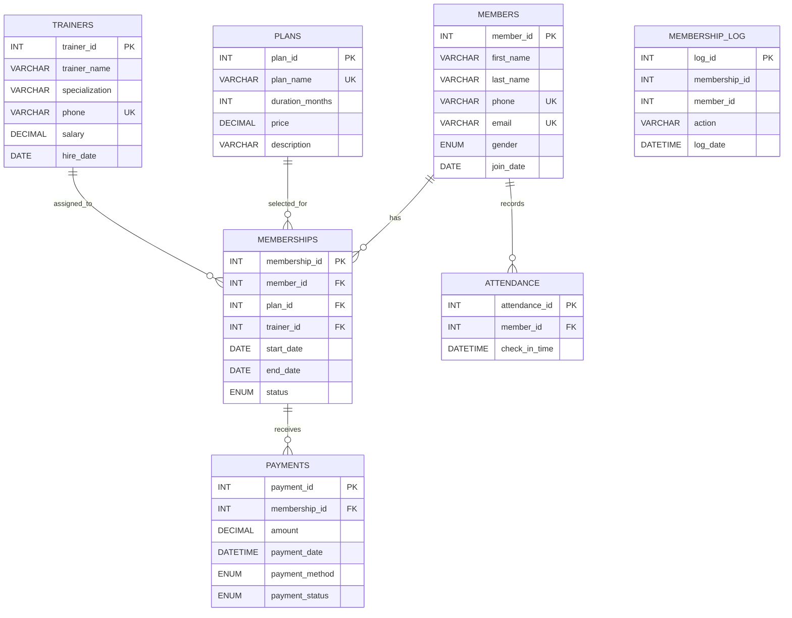

# Gym Membership Management System

A MySQL-based database management project designed to manage gym members, membership plans, trainers, payments, and attendance.

## Project Overview

The Gym Membership Management System is a database project developed using MySQL. It helps organize gym operations by maintaining member records, tracking memberships, managing payments, recording attendance, and generating useful reports.

This project demonstrates practical SQL concepts including database design, constraints, joins, aggregate functions, views, triggers, transactions, and CSV data handling.

## Objectives

- Maintain gym member information.
- Manage membership plans and their durations.
- Store trainer information and specializations.
- Track memberships and their expiry dates.
- Record payments and payment methods.
- Maintain member attendance records.
- Generate reports for gym management.

## Technologies Used

- **Database:** MySQL 8.0
- **Database Tool:** MySQL Workbench / MySQL Shell
- **Version Control:** Git and GitHub
- **Data Import/Export:** CSV
- **Backup:** MySQL `mysqldump`

## Database Structure

The project contains seven tables:

| Table | Purpose |
|---|---|
| `members` | Stores gym member details |
| `plans` | Stores membership plans and prices |
| `trainers` | Stores trainer details |
| `memberships` | Tracks member subscriptions |
| `payments` | Stores membership payment records |
| `attendance` | Records member check-ins |
| `membership_log` | Maintains a log of new memberships |

### Entity Relationship Diagram (ER Diagram)

The following ER diagram illustrates the database tables, their attributes, primary keys, foreign keys, and relationships.



### Table Relationships

- One member can have multiple memberships.
- One plan can be associated with multiple memberships.
- One trainer can manage multiple memberships.
- One membership can have multiple payment records.
- One member can have multiple attendance records.
- New membership records are automatically logged in `membership_log`.

## SQL Concepts Implemented

- Primary Keys and Foreign Keys
- `NOT NULL`, `UNIQUE`, `DEFAULT`, `CHECK`, and `ENUM` constraints
- `AUTO_INCREMENT`
- `WHERE`, `LIKE`, `BETWEEN`, and `IN`
- `INNER JOIN` and `LEFT JOIN`
- `GROUP BY`, `HAVING`, and `ORDER BY`
- Aggregate functions such as `COUNT()` and `SUM()`
- `UPDATE` and `DELETE`
- Database Views
- `BEFORE INSERT` and `AFTER INSERT` Triggers
- Transactions using `COMMIT`, `ROLLBACK`, and `SAVEPOINT`
- CSV Import and Export
- Database Backup and Restore

## Views

The project includes three views:

1. `v_membership_summary` – Displays membership information along with member, plan, and trainer details.
2. `v_plan_membership_report` – Displays the number of memberships associated with each plan.
3. `v_expiring_memberships` – Displays active memberships expiring within the next seven days.

## Triggers

Two triggers are implemented:

1. `trg_membership_before_insert` – Automatically calculates the membership end date using the selected plan's duration.
2. `trg_membership_after_insert` – Automatically inserts a log entry when a new membership is created.

## Transactions

Transactions demonstrate how to manage database changes safely using:

- `COMMIT` to save changes.
- `ROLLBACK` to undo changes.
- `SAVEPOINT` to partially roll back a transaction.

## Reports and Queries

The project includes reports such as:

- Total members.
- Membership count by plan.
- Revenue generated by trainers.
- Monthly new member registrations.
- Members without attendance records.
- Members with payments above a specified amount.
- Memberships expiring within the next seven days.

## CSV Import and Export

- Member information is imported from a CSV file.
- Membership summary and expiry reports are exported to CSV files.

## Backup and Restore

A complete database backup was created using MySQL `mysqldump`.

The backup was also restored into a separate database to verify that the database structure and records could be recovered.

## Project Folder Structure

```text
gym-membership-management/
│
├── .gitignore
├── LICENSE
├── README.md
│
├── sql/
│   ├── 01_create_database_tables.sql
│   ├── 02_insert_sample_data.sql
│   ├── 03_select_queries.sql
│   ├── 04_update_delete.sql
│   ├── 05_views.sql
│   ├── 06_triggers.sql
│   ├── 07_transactions.sql
│   └── 08_import_export.sql
│
├── data/
│   └── members_import.csv
│
├── documentation/
│   ├── data_dictionary.md
│   └── er_diagram.mmd
│
├── screenshots/
│   ├── database_tables/
│   ├── query_outputs/
│   └── triggers_views/
│
└── backup/
    └── gym_management_backup.sql
```

## How to Run the Project

1. Install MySQL Server 8.0 or later.
2. Open MySQL Workbench or MySQL Shell.
3. Execute the SQL files in the following order:

   1. `01_create_database_tables.sql`
   2. `06_triggers.sql`
   3. `02_insert_sample_data.sql`
   4. `05_views.sql`
   5. `08_import_export.sql`
   6. `03_select_queries.sql`
   7. `04_update_delete.sql`
   8. `07_transactions.sql`

**Important:** The CSV import should be performed only once on a fresh database. The import/export script also requires the configured MySQL secure file directory. The SQL files should be executed in the specified order.

## Learning Outcomes

Through this project, I gained practical experience in:

- Designing relational databases.
- Creating tables and establishing relationships.
- Writing SQL queries for real-world requirements.
- Implementing views and triggers.
- Managing transactions.
- Importing and exporting CSV data.
- Performing database backup and restoration.
- Using Git and GitHub for project management.

## Author

**Aditya Kumar Tiwary**

GitHub: [Aditya-Kumar-Tiwary](https://github.com/Aditya-Kumar-Tiwary)

Project: [Gym Membership Management System](https://github.com/Aditya-Kumar-Tiwary/gym-membership-management)
